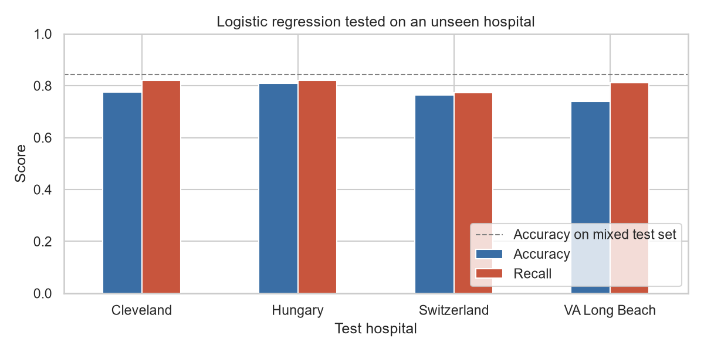
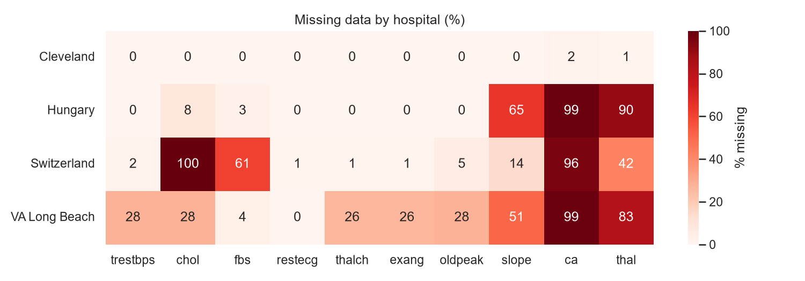
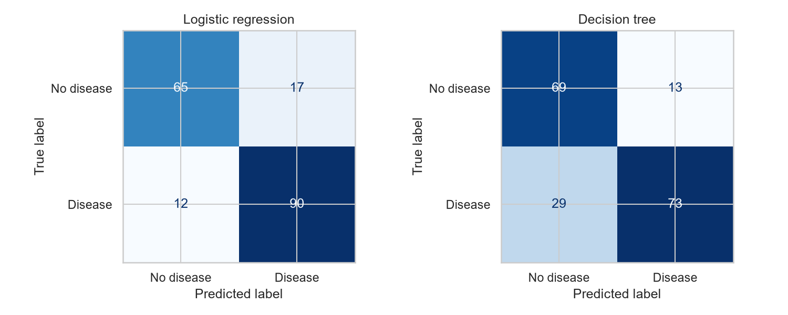
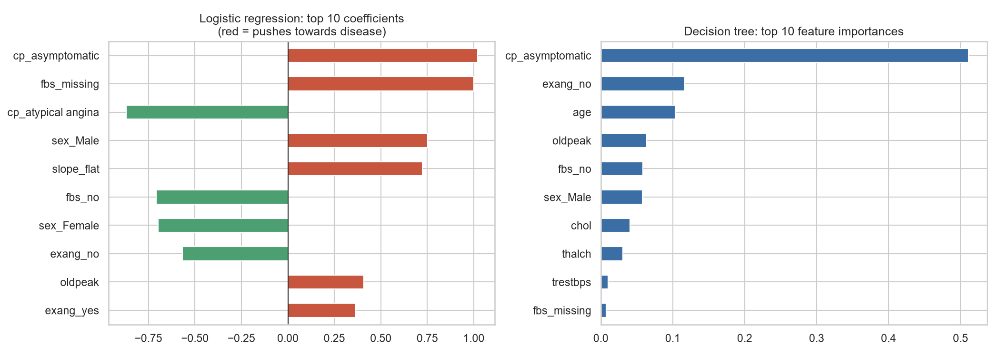

# Heart Disease Prediction from Multi-Hospital Clinical Data

Predicting whether a patient has coronary heart disease from routine clinical measurements, using messy real-world data from **four hospitals**. The project cleans the data, compares two models, and checks something many tutorials skip: **does a model trained at some hospitals still work at a hospital it has never seen?**



## The problem

Doctors decide who to send for invasive tests such as coronary angiography. A model that flags likely heart disease from cheap, routine measurements (age, blood pressure, an exercise ECG) could help prioritise patients.

In this setting the two kinds of error are not equal. Missing a patient who has heart disease (a **false negative**) is far worse than a false alarm, which only leads to more tests. So alongside accuracy, the main metric here is **recall for disease**: of the patients who really have disease, how many does the model catch?

## Dataset

[Heart Disease dataset](https://archive.ics.uci.edu/dataset/45/heart+disease), UCI Machine Learning Repository (Janosi, Steinbrunn, Pfisterer & Detrano, 1988; licensed CC BY 4.0). I used the combined Kaggle version, `heart_disease_uci.csv`, which is included in this repo.

- **920 patients** referred for coronary angiography in the 1980s
- **4 hospitals:** Cleveland, USA (304), Hungary (293), VA Long Beach, USA (200), Switzerland (123)
- **14 clinical features:** age, sex, chest pain type, resting blood pressure, cholesterol, fasting blood sugar, resting ECG, max heart rate, exercise-induced angina, ST depression, ST slope, number of vessels (`ca`), thallium test (`thal`)
- **Target:** `num` (0 = no disease, 1–4 = increasing severity), turned into a yes/no label: disease if `num > 0`. 55.3% of patients have disease.

The hospitals are very different. Only 36% of Hungarian patients have disease, compared with **93.5%** of Swiss patients.

## Method

1. **Find the data quality problems.** Besides blank cells, 172 cholesterol values (18.7%) were recorded as **0**, which is impossible for a living patient. All 123 Swiss patients have cholesterol = 0, so it was simply never measured there. Missing data depends heavily on the hospital:

   

2. **Clean the data.**
   - Cholesterol or blood pressure of 0 → treated as missing.
   - Dropped `ca` (66.4% missing) and `thal` (52.8% missing): filling in that much would mostly be guessing.
   - Dropped the hospital column, so the model can't learn "which hospital" instead of "which patient".
3. **Explore.** Disease rates by sex, chest pain type and exercise angina; distributions of age, max heart rate and ST depression.
4. **Build a scikit-learn `Pipeline`.** Numbers: fill gaps with the median, then standardise. Categories: fill gaps with `"missing"`, then one-hot encode. Because this sits inside the pipeline, fill values are learned from training data only (no data leakage).
5. **Train and compare** logistic regression and a depth-4 decision tree on a stratified 80/20 split, then confirm with 5-fold cross-validation.
6. **Leave-one-hospital-out test.** For each hospital, train on the other three and test on it.
7. **Threshold tuning.** See how lowering the probability cut-off trades false alarms for fewer missed cases.

## Results

### Model comparison (test set, 184 patients)

| Model | Accuracy | Precision | Recall (disease) | F1 |
|---|---|---|---|---|
| **Logistic regression** | **0.842** | 0.841 | **0.882** | **0.861** |
| Decision tree (depth 4) | 0.772 | 0.849 | 0.716 | 0.777 |

5-fold cross-validation agrees: logistic regression **82.0% ± 2.5** accuracy and **0.85** recall, versus 75.1% ± 2.3 and 0.75 for the tree. On the test set, the tree missed **29** patients with disease; logistic regression missed **12**.



### What drives the predictions

Both models agree on the strongest signals: **asymptomatic chest pain**, **exercise-induced angina**, **ST depression** (`oldpeak`) and **male sex**.



Surprisingly, *asymptomatic* chest pain has the **highest** disease rate. Everyone in this dataset was already referred for angiography, so a patient with no chest pain was probably sent for some other strong reason. How patients were selected shapes what the data shows.

### Testing on an unseen hospital

| Test hospital | Patients | % with disease | Accuracy | Recall |
|---|---|---|---|---|
| Cleveland | 304 | 45.7 | 0.776 | 0.820 |
| Hungary | 293 | 36.2 | 0.809 | 0.821 |
| Switzerland | 123 | 93.5 | 0.764 | 0.774 |
| VA Long Beach | 200 | 74.5 | **0.740** | 0.812 |

Accuracy drops from **84.2%** on a mixed test set to between **74.0% and 80.9%** on a hospital the model has never seen. This is **dataset shift**: patients, equipment and recording habits differ between sites. (Switzerland has only 8 healthy patients, so its accuracy mostly reflects recall.)

### Catching more disease

| Threshold | Recall | Precision | Missed disease | False alarms |
|---|---|---|---|---|
| 0.5 (default) | 0.882 | 0.841 | 12 | 17 |
| 0.4 | 0.922 | 0.790 | 8 | 25 |
| 0.3 | 0.951 | 0.764 | 5 | 30 |
| 0.2 | 0.980 | 0.725 | 2 | 38 |

Lowering the threshold to 0.3 cuts missed cases from 12 to 5 at the cost of 13 extra false alarms. (This table uses the test set for illustration only; in practice the threshold should be chosen on a separate validation set.)

## What I learned

- **"Missing" can hide behind real-looking values.** A cholesterol of 0 isn't a number, it's a missing test. Checking value ranges, not just blank cells, found 172 more missing values.
- **Missing data can leak information.** Even after dropping the hospital column, *fasting blood sugar missing* became one of the strongest predictors. It is missing for 61% of Swiss patients, and 93.5% of Swiss patients have disease. The model partly learned "this looks like a Swiss record" rather than anything about the patient.
- **A good test score isn't the whole story.** 84% on a random split fell to 74% at an unseen hospital. Before using a medical model somewhere new, you need to test it there.
- **Choose metrics that match the cost of mistakes.** The decision tree had slightly higher precision but missed more than twice as many sick patients.
- **Shared objects in scikit-learn pipelines are shared, not copied.** My first version reused one preprocessing object across several pipelines. Training the leave-one-hospital-out models silently re-fitted the main model's preprocessing and broke a later cell. Wrapping it in `sklearn.base.clone()` fixed it.
- **Simple models can win.** On 920 patients, logistic regression beat the decision tree on every metric except precision, and it is easier to explain.

## Limitations

- Data from the 1980s at four sites; diagnosis methods and patient populations have changed.
- Every patient was already referred for angiography, so this is **not** a general-population screening sample.
- Missing values were filled with simple rules (median / "missing" category); other choices could change the results.
- Small sample (920 patients). This is a learning project, **not a clinical tool**.

## How to run

**Option 1: Google Colab (no setup).** Open `heart_disease_prediction.ipynb` in [Colab](https://colab.research.google.com/) (File → Upload notebook, or the GitHub tab), run the first cells, and upload `heart_disease_uci.csv` when asked. Then use Runtime → Run all.

**Option 2: on your own computer** (Python 3.10+):

```bash
git clone https://github.com/ayushig-healthtech/Heart_Disease_Prediction.git
cd Heart_Disease_Prediction
python -m venv .venv
# Windows: .venv\Scripts\activate    macOS/Linux: source .venv/bin/activate
pip install -r requirements.txt
jupyter notebook heart_disease_prediction.ipynb
```

Run all cells in order. Charts are saved to `images/`.

## Repository contents

```
├── heart_disease_prediction.ipynb   # full analysis, with outputs
├── heart_disease_uci.csv            # dataset (UCI Heart Disease, CC BY 4.0)
├── images/                          # charts used in this README
├── requirements.txt
└── README.md
```
